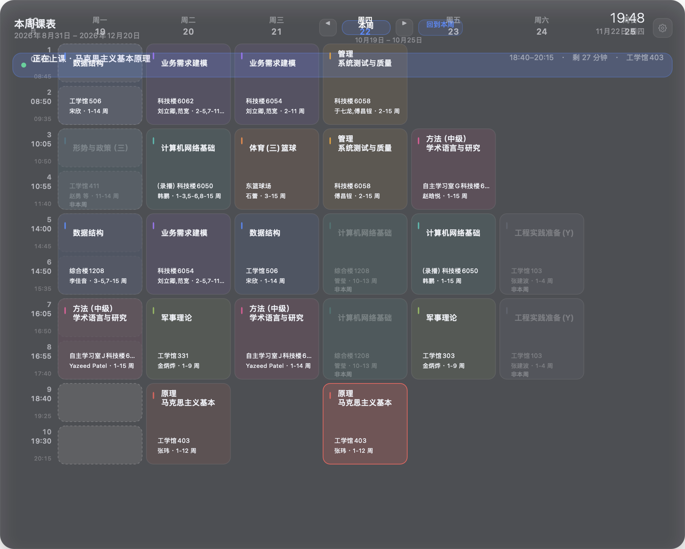

# DesktopTimetable · 桌面课表

> 一个零依赖、纯原生的 macOS 桌面课表。
> A zero-dependency, fully native macOS desktop timetable.

把教务系统导出的课表变成桌面上一张会呼吸的卡片：鼠标靠近时渐显、移开时渐隐，
点击课程看详情，点右上角齿轮改设置。



Turn your exported timetable into a living card on your desktop: it fades in as
the pointer approaches and fades out when you leave. Click a course for details,
click the gear to configure.

---

## 特性 · Features

- **零依赖**：不需要 Übersicht、Python、Node 或任何网络访问，只要 macOS 12+
- **原生 AppKit**：窗口、菜单、设置面板都是 Swift/AppKit；课表卡片本身是一份
  **内置网页**（`Resources/Timetable.{html,css,js}`，无框架、无构建步骤）由系统 WebKit 渲染，
  默认 **B 模式**直接上屏（`WKWebView` 挂在桌面层窗口里），不截图、不贴图
- **桌面层窗口**：卡片待在桌面图标层，不会挡住正常窗口
- **图钉固定**：卡片**左上角、标题「我的课表」右边**一个大头针（与标题行平行）——
  **空心**时可以拖着课表到处跑（窗口 1:1 跟随鼠标），点一下变**实心**就把位置锁住，
  再点一下解锁；位置和固定状态都会记住，重启后原样恢复
- **弹窗跟着课表走**：设置面板、课程编辑器、确认框、导入窗口…… 全部以**课表当前中心**出现，
  不会再跑到屏幕正中跟你抢注意力
- **多课表**：新建 / 切换 / 重命名 / 删除，标题与副标题跟着课表走
- **课表大小可调**（1.3.0）：设置 → 外观 →「课表大小」滑块，70% ~ 当前屏幕能放下的最大
  （这台约 113%），**整体等比缩放**（宽高同一个系数，不拉伸版式）；卡片放大贴边时会被夹回屏幕可见区，**整张卡片始终完整可见**；
  缩放锚点是**卡片中心**，课表原地胀大 / 缩小；拖动中实时预览、松手才写盘（放大档松手后
  切回 `pageZoom`，文字清晰不发糊）；**上次的大小会记住，重启后按同一个比例出来**；**缩放之后照样能拖到屏幕边缘**（贴着可见区，不多不少）；
  **放到最大也不会被裁**（卡片始终摆在画布正中，窗口位置跟着卡片走）；
  只影响桌面上的课表，不影响设置面板本身
- **折叠 / 展开**：状态条最右侧的**折线按钮**（⌄ / ⌃），一键把课表收成
  「顶栏 + 状态条 + 表头」一条（100% 档约 173pt），**顶边不动、0.3s 过渡**；
  折叠态点日期会先展开再打开当天面板；重启默认展开（不记忆折叠状态）
- **单周临时覆盖**：某一周临时换课 / 调课，只影响声明的那几周，可一键撤销
- **导入教务系统导出的 `.xls`**：自动处理 `rowspan` 合并单元格、多课同格
- **导入 JSON**：宽松字段解析（`"周四"` / `"星期四"` / `"第5-6节"` 都认）
- **覆盖导入只在需要时询问**：有时间冲突才打开差异页；导入里少了你新增 / 改过的课会逐门问保留还是删除，普通新增 / 更新直接覆盖
- **右键编辑**：新增课程、编辑课程、添加上课时间、删除单次 / 整门课
- **渐隐渐显**：变实/变虚秒数、静置/悬停不透明度都可在设置里调；
  **系统权限弹框（定位 / 日历 / 提醒事项 / 通知）开着的时候课表不会淡出**，
  方便一边看课表一边点「允许」
- **周次浏览**：本周 / 全部周次 / 任意一周，左右箭头切换
- **日期覆盖层**：点表头的某一天，就在那一列展开当天的面板 ——
  课程、系统**提醒事项**（可直接勾选完成 / 添加 / 删除 / 修改）、系统**日历日程**，
  以及农历、节气、节日、天气和宜忌；表头红点 = 有待办、橙点 = 有日程，
  再点同一列日期收起。接入系统日历 / 提醒事项和显示天气都在设置里单独开关（默认关）
- **待办右键菜单**：右键待办弹**原生菜单**（修改… / 删除 / 取消）——
  「修改…」在待办卡片里就地把标题和到期时间改掉（回车保存、Esc 取消），
  「删除」立即删（不二次确认）；添加待办也能填到期时间（留空 = 当天 00:00）
- **输入时锁定当前列**：正在添加 / 修改待办时，**指针滑到别的列不会换列、也不会收走面板**
  （打了一半的字不会丢）；Esc 取消或回车提交后立刻恢复跟随
- **待办输入框随时能打字**：点「＋ 添加待办」之后**直接就能打字**（不用再点一下输入框），
  取消一次就收起；**关掉再打开还是照样能打字、取消也只需要点一下**
  （1.4.5 修：以前第二次打开键盘进不去、「取消」要点两下）
- **时间输入不打断自己**：在标题框 / 「时」框 / 「分」框之间来回点，
  **键盘不会断**（不用重新点一次输入框），输入时间时**上面的待办事项也不会消失**
  （1.4.6 修：以前切框会把表单整块重画 → 待办卡被换掉、键盘断开）
- **日记**：日期覆盖层里和「待办事项 / 日历行程」并列的**第三块内容**
  （琥珀色竖条那张卡）。点「＋ 写日记」写标题 + 正文；点已有的一条进入编辑态，
  可以修改或删除。数据存在 `<数据目录>/diary.json`，**不进系统日历 / 提醒事项**；
  在设置 →「日记」板块里可以集中管理（列表 / 新建 / 编辑 / 删除）。
- **已完成的提醒事项**：设置 → 提醒 →「日期覆盖层」卡片里的第三行，默认收起；
  点开就在卡片内展开，跨**所有清单**查看已完成项（每行带清单名），
  可搜索 / 按清单筛选、恢复为未完成、删除单条，或全部删除
  （重新统计数量；≥50 条要输入「删除」；批量提交，部分失败如实报数）
- **课程时间自定义**：设置面板「课表」板块里有一张「课程时间自定义」卡片（在「课程预览」下面），
  内置滚动列表可改 10 节课的起止时间；改完立刻写盘，卡片时间列 / 倒计时 / 提醒同步更新
- **上课提醒**：系统通知，提前 N 分钟提醒，14 天滚动排程（macOS 12+）
- **登录自启**：`SMAppService`（macOS 13+；macOS 12 会说明不支持）
- **命令行导入**：`DesktopTimetable --import 课表.xls`，适合脚本化
- **自带测试**：不依赖 XCTest，`make test` 一条命令跑完
- **版本号可见**：设置 → 系统 板块最下面是当前版本（从 App 的 `Info.plist` 读），
  反馈问题时报版本即可

---

## 构建 · Build

只需要 macOS 的 Command Line Tools（`xcode-select --install`）：

```bash
git clone https://github.com/<your-name>/DesktopTimetable.git
cd DesktopTimetable
make app          # 编译并生成 build/DesktopTimetable.app
make test         # 跑测试
make run          # 编译并以 B 模式启动
make run-a        # 编译并以 A 模式（快照）启动，用于回归
make install      # 同步到项目根目录的当前版 App（DesktopTimetable-$(VERSION).app）
make dmg          # 打包 dmg
```

`make` 用的是 `swiftc` 直接编译（不需要完整 Xcode）。
如果你更习惯 SwiftPM / Xcode，仓库里也带了 `Package.swift`，可以用 Xcode 打开。

> The build uses `swiftc` directly, so only the Command Line Tools are needed —
> no full Xcode, no SwiftPM. A `Package.swift` is included if you prefer Xcode.

---

## macOS 26 的菜单栏图标 · The macOS 26 menu bar gate

macOS 26（Tahoe）给第三方菜单栏图标加了一道系统级开关：
**系统设置 → 菜单栏 → 「允许在菜单栏中显示」**，默认不打开的 App 会被系统悄悄藏起来
（`NSStatusItem` 创建成功、`isVisible` 也是 true，但图标就是不出来）。

桌面课表检测得到这种情况，会在设置面板里直接提示，并给一个「打开菜单栏设置…」按钮。
不打开这个开关也不影响使用：点课表卡片右上角的齿轮，
或者运行 `open desktoptimetable://settings` 都能打开设置。

---

## 使用 · Usage

1. 启动后卡片会出现在桌面右上角，菜单栏会出现一个日历图标。
2. 点卡片右上角的齿轮（或菜单栏 → 打开设置…）打开设置面板 ——
   面板以**小长条**出现在屏幕正中间，里面只有四个板块：
   **外观 / 课表 / 提醒 / 系统**（每块是一个「图标在上、名称在下」的方块，
   点整块都行）。
3. 点一个板块，窗口原地**平滑扩张**成那个板块的设置页；
   顶部是「‹ 返回 + 板块名」，下面就是该板块的设置项。
   点「返回」收缩回长条。
4. 「导入课表…」选择教务系统导出的 `.xls` 文件（在「课表」板块里）。
5. 设置开学日期（决定当前是第几周，在「课表」板块里）。

数据存在：

```
~/Library/Application Support/DesktopTimetable/
├── config.json            **只放外观**（渐隐渐显 5 项）—— 全局，旧版也读
├── settings.json          新功能设置（提醒 / 作息 / 笔记 / 桌宠）+ schemaVersion
├── window_state.json      课表窗口状态（图钉固定与否 + 窗口位置）
└── timetables/
    ├── index.json         课表索引（当前是哪一份 + 全部课表的清单）
    ├── <uuid>/
    │   ├── meta.json      这份课表的名称 / 副标题
    │   ├── schedule_data.json   课程数据
    │   ├── semester.json        开学日期 + 学期总周数
    │   ├── week_overrides.json  单周临时覆盖（没有覆盖时不存在）
    │   └── backups/             写盘前自动备份
    └── backups/           删除课表前备份整个目录
```

`config.json` 与 `settings.json` 为什么分开，见「[设置文件](#settingsjson--新设置1-1-0)」。

首次运行会自动从旧版目录 `~/.config/timetable/` 迁移数据；
旧版根目录的 `schedule_data.json` / `semester.json`
会**自动迁移成第一份课表**（迁移前备份，旧文件保留在原地不删）。

### 图钉固定与位置记忆 · Pin & window position

课表卡片**左上角、标题「我的课表」右边**有一个大头针按钮（与标题行平行，
紧贴标题文字右侧；标题改名后图钉会跟着移动）：

| 图钉外观 | 状态 | 能拖吗 |
|---|---|---|
| **空心**（只有描边） | 未固定 | ✅ 拖卡片空白处就能移动整个课表 |
| **实心**（内部填充） | 已固定 | ❌ 位置锁住，拖不动（图钉本身仍可点） |

- 两态**只有空心 / 实心的区别**：形状、大小、颜色、位置完全一致。
- 点一下图钉在两种状态之间切换，切换**立刻生效**。
- 拖动时课表窗口**1:1 跟随鼠标**（抓取点始终在鼠标下），不会滞后或只跟一半。
- 拖动时课表**不会整个跑出屏幕** —— 超出可见区会自动夹回来。
- 位置和固定状态都写在 `window_state.json` 里，**重启 App 后原样恢复**；
  第一次启动用默认位置（靠左上）。
- 固定后，所有后续弹出的窗口（设置面板、课程编辑器、确认框、导入相关窗口……）
  都以**课表当前中心**为锚点出现；课表拖到哪儿，弹窗就跟到哪儿。
  弹窗超出屏幕可见区时会被夹回屏幕内。
- 弹窗外观：**深色玻璃底（上浅下深的竖向渐变）+ 一圈边缘假光**（上亮下暗），
  不再是一块实心黑；圆角 / 红绿灯都在材质上，四个角一致（1.4.7 调，1.4.8 沿用）。
- 多显示器时以**课表所在的那块屏**为准。

### 多课表 · Multiple timetables

| 操作 | 入口 |
| --- | --- |
| 新建 / 切换 / 重命名 / 删除 | 菜单栏 →「课表」子菜单，或设置面板 →「课表」卡片 |
| 导入课表 | 菜单栏 →「课表 → 导入课表…」、设置面板「导入课表…」、右键菜单「导入课表…」 |

已有课表时导入，会先问「覆盖当前课表 / 新建一份独立课表 / 取消」，**默认是覆盖**：

- **覆盖当前课表** —— 普通新增 / 更新直接写入，不弹差异页；
  有时间冲突或匹配关系不唯一时才进「差异合并页」逐项选择「保留当前 / 用导入」；
  导入里少了你新增 / 改过 / 旧数据课表里的课时，会**逐门问「保留 / 删除」**，
  不替你做决定；
- **新建一份独立课表** —— 保留当前课表不动，导入为一份新课表（全新 `courseID`），
  并自动切过去，两张表互不影响；
- **取消** —— 什么都不写。

删除课表前会备份整个课表目录；删掉当前课表会自动切到另一份，
删掉最后一份则进入空课表状态。

### 右键编辑 · Context menu

在卡片上右键点击课程格：

| 菜单项 | 说明 |
| --- | --- |
| 新增课程 | 在这个格子里加一门课 |
| 查看 / 编辑课程 | 改课名、教师、地点、周次；同一门课的多个上课时间会一起显示 |
| 添加上课时间 | 给已有课程再加一个上课时间（同一个 `courseID`） |
| 删除这一次 | 只删这条上课时间 |
| 删除整门课 | 删掉这门课的全部上课时间 |

保存前会做校验（`day` / `block` 合法、`weeks` 非空且不超学期周数）并检测冲突，
冲突不静默覆盖 —— 让你选「仍然保存」还是「返回修改」。

### 待办右键菜单 · Day panel todo menu

在日期覆盖层里**右键一条待办**：

| 菜单项 | 说明 |
| --- | --- |
| 修改… | 在**待办卡片里**就地编辑（不新开窗口）：标题 + 到期时间 |
| 删除 | 立即删除（沿用淡出动画），**不弹二次确认** |
| 取消 | 什么都不做（也可以点空白处或按 Esc 关掉菜单） |

- 菜单是**系统 `NSMenu`**，和课程右键菜单同一套弹法 ——
  日期面板会滚动、有裁剪和渐隐，网页里画的菜单容易被裁掉。
- **指针在表头附近移动时，面板不会乱闪**：指针移到表头上方（顶栏 / 状态条，
  还在课表里）面板**不会收**；滑回表头时面板是**平滑地重新揭开**，
  不会「突然出现一下又渐渐出现」。
- **菜单弹出时覆盖层不会消失**：菜单是用一个临时的浮层面板当宿主的，
  菜单一弹出指针就离开了卡片 —— 原生会在这段时间里告诉网页「菜单开着」，
  覆盖层既不会被收走、也不会跟着指针换列。
- **点菜单不会让课表整体闪一下**：菜单开着的时候课表**一律不淡出**
  （菜单是个弹出窗口，原生一度以为「指针离开了课表」）；
  待办菜单**往左弹**（日期覆盖层在最右列，往右弹会伸出课表边缘）；
  菜单关掉后还有 3 秒宽限期，课表不会因为「指针刚好在课表外面」而淡掉。
- 「修改…」里：自动聚焦标题，**回车保存**、**Esc 取消**；
  标题为空不允许保存；时间必须是 `00:00–23:59`，非法时就地提示、不提交。
- 修改后的标题 / 时间**写回系统「提醒事项」**；完成状态、清单归属都不变。
- 「添加待办」的输入区是**两行**：上面写内容，下面 `时 : 分` + 「**取消**」；
  - 时间留空 = 当天 `00:00`，只收数字、失焦自动补零；
  - 右下角是「取消」不是「添加」—— 点了放弃这次输入（并清空），
    **提交靠回车**（标题框、时间框里回车都行）。
  - 点「＋ 添加待办」之后**输入框自动聚焦**，可以直接打字；
    **取消点一次就收起**，关掉再打开也一样（1.4.5 修）；
    标题框 / 时框 / 分框之间来回点不会断键盘，上面的待办也不会消失（1.4.6 修）。
- 只处理**提醒事项**；系统日历里的日程不提供修改 / 删除。
- 非当天的列（翻周后点开的那一天）同样支持这些操作。

### 状态条：本周才有倒计时 · Status bar

| 视图 | 状态条显示 |
| --- | --- |
| 本周 | 实时上下课倒计时（「还有 12 分钟下课」） |
| 全部周次 | 只显示周总结（本周几门课 / 多少节） |
| 其他任意一周 | 只显示该周的周总结 |

这条规则在 `TimetableState.status` 和 `Resources/Timetable.js` 两处都实现了：
**只看当前真实时间**，浏览别的周时不编造倒计时。

### 单周临时覆盖 · One-week overrides

只改某几周的课，不动原课表：

- 覆盖写进**独立的 `week_overrides.json`**，不混进 `schedule_data.json`；
- **只影响覆盖里声明的那些周**，其他周仍然显示原课；
- 被覆盖的那条原记录存在 `restored` 里，撤销覆盖时原样放回；
- 「全部周次」视图**忽略覆盖**（那是给整体课表看的）；
- 卡片上被覆盖的格子有「覆」标记；
- 撞上「正常在上的课」和「非本周的课」各有一道确认，两道关串行；
- 同一格有冲突时可以选「替换」还是「保留两门」。

---

## 上课提醒与登录自启 · Reminders & login item

设置面板的**「提醒」板块**里有一张「提醒与启动」卡片
（外观 / 学期 / 课表 / 导入 / 预览那些卡片一个都没动，只是不再排在同一条长列表上，
而是各自归到对应板块的页面里）。

### 上课提醒

用系统 `UserNotifications`（不是废弃的 `NSUserNotification`，也没有第三方依赖）。

- **提醒内容**：`标题「10 分钟后上课」`、`正文「高等数学 · 08:00–09:35 · 教三-201」`；
  同一格有多门冲突课时**合并成一条**，课名用「 / 」连接。
- **提前量**：0 / 5 / 10 / 15 / 20 / 30 分钟可选，0 表示上课时提醒；
  下拉框最后一项是「自定义…」，可以填 0–60 的任意整数
  （填的值不是候选时，列表里会多列一项「提前 N 分钟（自定义）」，一眼看得出现在提前几分钟）。
- **规划范围**：从今天起 **14 天**，只看**当前激活课表**的教学周
  （`1…effectiveMaxWeek`），学期外、本周不生效、已经开始的课都不排。
- **覆盖规则**：规划复用 `TimetableState.displayCourses(for:)` 的语义 ——
  覆盖生效的那几周只提醒覆盖课，其他周仍提醒原课；
  「全部周次忽略覆盖」那条**视图**规则**不**适用于通知。
- **滚动续排**：启动后、导入 / 编辑 / 覆盖 / 切换课表 / 改学期 / 改提醒设置、
  跨天（午夜）、系统唤醒、app 切回前台时重排；
  指纹（课表 id + 课程 + 覆盖 + 学期 + 开关 + 提前量 + 日期）没变就跳过，
  **不会**在每 10 秒的卡片刷新里删了重排。
- **上限**：系统上限 64 条，本应用硬上限 **60** 条；超出按触发时间保留最早的 60 条，
  丢弃条数记进日志（不静默截断）。
- **退出不丢**：退出 app **不**清空已排通知，系统会继续按时投递；重新启动后重新规划。
- **权限**：首次打开提醒开关时请求 `.alert + .sound`（先激活 app，否则弹窗会藏在后台）。
  已经拒绝过就**不再**反复弹系统框，设置面板显示「系统通知未授权」并给一个「打开通知设置」按钮。
  前台也显示横幅 / 声音（实现了 `UNUserNotificationCenterDelegate`）。
- **测试提醒**：「发送测试提醒」按钮 5 秒后发一条 `dt.test.*` 通知，不进正式规划；
  启动时会清理上次遗留的测试通知。
- **按钮按授权状态置灰**：只有在「系统通知已授权 **且** 提醒开关已开 **且** 非自动化模式」
  时，「发送测试提醒」才可点。授权状态是**异步**读的，界面缓存上一次的结果
  （不阻塞主线程，也不会先置灰再点亮闪一下）；未授权时按钮置灰，
  状态行仍显示「系统通知未授权」，「打开通知设置」按钮保留。

### 登录自启

- macOS 13+ 用 `SMAppService.mainApp`；`Info.plist` 的最低版本仍是 **12.0**。
- **macOS 12**：开关置灰，并写明「登录自启需要 macOS 13 或更高版本」。
  不用 `LaunchAgent`、不用废弃 API 偷偷顶替。
- **状态以系统为准**，不往设置文件里存 bool（用户可以在系统设置里手动关掉）：

| 系统状态 | 界面 |
| --- | --- |
| `.enabled` | 已开启 |
| `.notRegistered` | 未开启 |
| `.requiresApproval` | 等待系统允许 +「去系统设置允许」按钮 |
| `.notFound` | 「开启失败」+ 真实说明（app 可能不在「应用程序」文件夹，或被系统的位置 / 签名限制挡住） |
| 未知状态 / 抛错 | 显示真实错误，开关回到真实状态（不假装成功） |

> ad-hoc 签名的 app 从 `build/` 里注册时可能被系统拒绝。
> 这种情况界面会把真实错误显示出来，**不会**用私有手段绕过。
> 手工试注册后请立刻关掉，避免留下指向 `build/` 的失效登录项。

### 自动化模式不碰系统

`--verify-*`、`--render-card`、`--import`、`--dump-layout` 和测试运行器
都在 `AutomationMode` 里被识别为自动化模式：**不请求通知权限、不注册登录项、不发真实通知**。

> **每个 `--verify-*` 都必须登记在 `AutomationMode.automationFlags` 里。**
> 漏登记的后果不是「测试数字错」，而是那次自检**以非自动化模式运行**：
> 自动化护栏失效 → `refreshReminderSchedule()` 不再提前返回 →
> `clearAll()` 打到了**同一 bundle id 的真实系统通知中心**，
> 把你已经排好的上课提醒清掉。
>
> `Tests/main.swift` 里有一条回归测试：扫 `main.swift` 里出现的所有 `--verify-*`，
> 逐个断言它们都在 `automationFlags` 里 —— 以后新增自检忘了登记，会直接测试失败。

### 真机焦点自检（`--verify-focus-flow`）

「设置面板看得见但按钮点不动」这类问题，**从终端直接起进程是验不出来的**：
macOS 不给那种进程激活权，`NSApp.isActive` 恒为 false、`window.isKeyWindow` 恒为 false，
断言会变成「永远为真的假断言」。

所以焦点自检必须**经 LaunchServices 启动**（`make verify` 里的 `open -n`），
并且跑在**真正的 `NSApplication` 事件循环**里
（手动 `RunLoop.run` 顶出来的循环也不行 —— 那样 `isActive` 仍是 false）。

它验的是一条完整链路：

1. app 真的成了 active app（`NSApp.isActive`）；
2. 覆盖导入 → 差异页 → **真点**「应用」按钮（构造真的鼠标事件走 AppKit 命中测试，
   不是直接调 action）；
3. 差异页关掉之后，设置面板**拿回了 key window**；
4. 面板里的数据换成了新课表（焦点对了但数据没刷新，同样是用户可见的 bug）；
5. **真实按键**（Esc）能被面板接住 —— 键盘进不去 = 面板不是 key window。

> 直接调 action 只能证明「回调连着」，证明不了「用户点得到」——
> 而「点了没反应」正是用户报的现象。所以这一步必须是真实事件。

### 手工验收辅助

两个**只读 / 可回滚**的命令行入口，用来人工确认系统那两条链路真的通：

```bash
# 通知：只读当前授权状态 + 本应用待发通知条数（不请求权限、不发送）
build/DesktopTimetable.app/Contents/MacOS/DesktopTimetable --notifications-status

# 登录项：注册 → 读回状态 → **立刻注销**（不留残余登录项）
build/DesktopTimetable.app/Contents/MacOS/DesktopTimetable --login-item-selftest
```

- `--notifications-status` 输出两行：授权状态文案、待发通知条数（只列本应用自己的 id）。
- `--login-item-selftest` 会真的调一次 `SMAppService.register()`，读回状态后
  **马上** `unregister()`，把登录项恢复原样；如果系统拒绝（ad-hoc 签名、
  app 不在「应用程序」文件夹），它会打印**真实错误**而不是假装成功。
- 两个命令都**不会**弹通知授权框、**不会**留下真实通知。

---

## 支持的导入格式 · Supported import formats

| 格式 | 说明 |
| --- | --- |
| `.xls` | 教务系统「课表」页另存的表格（其实是 HTML 表格）。自动识别 `rowspan` 合并单元格。 |
| `.json` | 数组，字段：`day` / `block` / `name` / `teacher` / `loc` / `code` / `weeks` |

JSON 字段很宽松：

```json
[
  {
    "day": "周四",
    "block": "第5-6节",
    "name": "数据结构",
    "teacher": "宋欣",
    "loc": "工学馆506",
    "code": "3030112015.02",
    "weeks": "1-3,5-6,8-15"
  }
]
```

---

## 课程时间自定义 · Custom period times

课表网格固定 10 节（5 个 block）。每节的钟点可在设置面板的
**「课表」板块 →「课程时间自定义」**里改（卡片就放在「课程预览」下面）：

- **内置滚动列表**：10 行「第 N 节　[开始] – [结束]」，卡片高度固定，拖动右侧滚动条看完全部；
- **时 / 分两个框**：每个时间拆成「时」「分」两个输入框，中间的冒号是固定标签，
  不用输入；点进框里直接敲数字，回车或点到别处即保存；
- **自动补零**：`8` + `5` → `08:05`，分留空按 `00` 处理，失焦后统一显示成两位数；
- **校验**：格式非法、开始不早于结束、与相邻节次重叠 → 响一声并恢复原值，不写盘；
- **一键恢复默认**：卡片右上角「恢复默认」；
- **立即生效**：保存后写进 `settings.json` 的 `periods` 分组，
  并同步到当前进程 —— 卡片左侧时间列、课程块时间、状态条倒计时、上课提醒
  下次排程都用新作息，不用重启。

**只改钟点，不改节数**：网格行数（CSS `repeat(10, …)`）、
`Course.blockRange`、导入解析、提醒排程都绑定 10 节，增删节次要连带改版式，
不在这个设置里做。

---

## 数据格式 · Data format

### `schedule_data.json` —— 课表（数组）

> 阶段 3 起，这个文件在 `timetables/<uuid>/schedule_data.json`
> （旧的根目录路径会在首次启动时自动迁移）。

一条记录 = **一个上课时间**。同一门课的多个上课时间是**多条记录**，
共用同一个 `courseID`。

```json
[
  {
    "courseID": "B3F4A3F1-BD3D-4C0E-B754-24DD752E3E1D",
    "name": "数据结构",
    "code": "3030112015.02",
    "day": 1,
    "block": 0,
    "teacher": "宋欣",
    "loc": "工学馆506(学校本部)",
    "weeks": [1,2,3,4,5,6,7,8,9,10,11,12,13,14],
    "weeksLabel": "1-14"
  }
]
```

| 字段 | 层级 | 说明 |
| --- | --- | --- |
| `courseID` | 课程级 | 课程身份（UUID 字符串）。同一门课的所有上课时间共用。**老师不参与身份**。 |
| `name` / `code` | 课程级 | 课名、课程代码（可空）。 |
| `day` / `block` / `teacher` / `loc` / `weeks` | 上课时间级 | 逐条不同。 |
| `weeks` | — | **唯一事实来源**。 |
| `weeksLabel` | — | 只用于显示，保存时由 `weeks` 重新生成。 |

`day` 1–7（周一…周日），`block` 0–5（每 2 节课一个格 = 08:00–09:35 / 10:05–11:40 / …）。

### `semester.json` —— 学期配置

```json
{ "start": "2026-08-31", "maxWeek": 16 }
```

`maxWeek` 是学期总周数，缺省 16，合法范围 1–30。数据里若有课程超出，
不会静默隐藏：`effectiveMaxWeek = max(配置值, 数据里的最大周次)`，
并在设置面板提示。

### `week_overrides.json` —— 单周临时覆盖（数组）

```json
[
  {
    "day": 3, "block": 1, "weeks": [7],
    "name": "自习", "teacher": "", "loc": "图书馆",
    "code": "", "courseID": "…",
    "restored": {
      "name": "高等数学", "teacher": "李雷", "loc": "教三-201",
      "code": "MATH101", "courseID": "…",
      "day": 3, "block": 1, "weeks": [1, 2, 3, 4, 5, 6, 8]
    }
  }
]
```

- `weeks` —— 这次覆盖**只在**这些周生效；其他周照常显示原课。
- `restored` —— 被覆盖的那条原记录，撤销时原样放回。`null` 表示这门课本来就是新增的
  （撤销 = 删掉）。
- 文件损坏只会让它读不出来（降级成「没有覆盖」），**不影响课程数据本身**。

### `settings.json` —— 新设置（1.1.0+）

```json
{
  "schemaVersion": 1,
  "reminder": { "enabled": true, "leadMinutes": 10 },
  "periods": {
    "items": [
      { "start": "08:00", "end": "08:45" },
      { "start": "08:50", "end": "09:35" }
    ]
  },
  "notes": { "enabled": false },
  "pet": { "enabled": false }
}
```

- `schemaVersion` —— 格式版本，当前为 `1`。缺字段 / 类型非法一律退回默认值，不会崩。
- `reminder` —— 上课提醒开关与提前分钟数（0–60，下拉候选 0/5/10/15/20/30，
  另加一个「自定义…」入口可以填任意整数；只存 `leadMinutes` 一个整数，
  不另存「是不是自定义」—— 由「在不在候选里」推出来，老配置不用迁移）。
- `periods` —— 10 节课的起止时间（`items` 恰好 10 项，`HH:mm`）。
  少于 10 项、时间非法、开始不早于结束、或与相邻节次重叠 → **整份退回内置默认作息**，
  绝不半套生效。设置面板的「课程时间自定义」卡片读写的就是这一组。
- `notes` / `pet` —— **只预留结构**，本期没有对应功能。
- 读取失败（损坏 / 空文件）→ 全部用默认值 + 记录诊断，并先备份损坏文件；
  **不影响课表加载**。
- 写盘是「读-改-写」：别的版本 / 别的模块写进来的未知字段不会被抹掉。

### `window_state.json` —— 课表窗口状态（1.1.4+）

```json
{
  "pinned": true,
  "x": 182.0,
  "y": 37.0
}
```

- `pinned` —— 图钉是不是**实心**（`true` = 已固定，位置锁住）。
- `x` / `y` —— 课表窗口在**屏幕坐标系**里的原点（左下角）。
- 这个文件**只归桌面课表自己管** —— 设置面板保存时不会碰它，
  它写盘时也不会碰用户的课表数据 / 设置 / 壁纸。
- 文件不存在（第一次启动）→ 用默认位置 + 未固定。
- 文件损坏 → 退回默认（不会崩，也不会把课表锁死在屏幕上）。
- `pinned` 用**严格的布尔**读：JSON 里的 `1` 不算 `true`（`StrictJSONValue.bool`）。

### `config.json` —— 外观（**只有外观**）

```json
{ "fadeInSec": 0.8, "fadeOutSec": 6, "minOpacity": 0.22,
  "maxOpacity": 1, "panelOpacity": 1 }
```

旧版 app 也会读这个文件，而且它保存时是**整份覆盖**、只写它认识的这 5 项。
所以新设置（提醒 / 笔记 / 桌宠）**绝不能**写在这里 —— 旧版一保存就没了。

新版写 `config.json` 时改成「读旧文件 → 合并新键 → 原子写回」，
旧调用路径（`ScheduleStore.saveConfig([String: Double])`）也不会误删未知字段。

### `timetables/index.json` —— 课表索引

```json
{
  "activeID": "9F9907A3-…",
  "items": [
    { "id": "9F9907A3-…", "name": "2026 秋季", "subtitle": "计算机 2501",
      "createdAt": "2026-10-24T04:39:01+08:00", "updatedAt": "2026-10-24T04:39:01+08:00" }
  ],
  "legacyMigrated": true
}
```

- `activeID` —— 当前课表；必须指向 `items` 里真实存在的一份，否则读出来是 `null`。
- `items` —— 全部课表的清单（详细数据在各课表自己的目录里）。
- `legacyMigrated` —— 旧版数据是否已经迁移过。防止「删光课表后旧文件被复活」。

### `timetables/<uuid>/meta.json` —— 课表元数据

```json
{
  "id": "9F9907A3-…",
  "name": "2026 秋季",
  "subtitle": "计算机 2501",
  "createdAt": "2026-10-24T04:39:01+08:00",
  "updatedAt": "2026-10-24T04:39:01+08:00"
}
```

卡片标题读 `name`，副标题读 `subtitle` —— 代码里没有硬编码的个人姓名。
重命名只改这两个字段，**不改 `id`、不改 `courseID`**。

课表数据不进 UserDefaults；UserDefaults 最多存一个 `activeID`。

### `backups/` —— 自动备份

每次写盘前自动备份，保留最近 5 份：

```
backups/schedule_data-20261023-231428.json
backups/semester-20261023-231646.json
```

---

## 课程身份与分组 · Course identity

导入和旧数据迁移**共用同一套分组逻辑**（`CourseGrouper`，纯函数）：

1. `code` 非空 → 规范化后的 `code`；
2. `code` 为空 → 规范化后的课名；
3. 同一个 `code` 对应多个不同课名 → 改用 `code + name` 复合键，并报告数据异常。

规范化：trim、折叠空白、全角→半角、匹配时大小写不敏感；**显示保留原文**。

导入时与已有课程匹配：`code` 匹配 → 复用旧 `courseID`；`code` 为空且课名唯一匹配 → 复用；
匹配不唯一 → 不猜，预览里让用户选「合并到已有课程」或「新建」；匹配不上 → 新 UUID。

重复导入同一份文件是**幂等**的：课程数不变、`courseID` 不变、上课时间不重复。

### 差异合并页 · Diff merge

覆盖当前课表时，比较范围分三层：

| 层级 | 比较的字段 |
| --- | --- |
| 学期级 | 开学日期、学期总周数 |
| 课程级 | 课名、代码 |
| 上课时间级 | 星期、节次、教师、地点、周次 |

匹配规则（`TimetableDiff`，纯函数）：

1. 优先按 `courseID` 匹配；
2. 没有 `courseID` 的旧数据，按规范化 `code` 匹配；
3. `code` 为空再按规范化课名匹配；
4. **课名相同但 `code` 不同、或匹配到多组 → 不自动猜**，列在「需要确认」里；
5. 匹配上的课程**一律复用旧 `courseID`**；新增课程用新 UUID。

默认选择（来源感知，防静默覆盖 / 防静默删课）：

| 情况 | 默认 |
| --- | --- |
| 有差异的已有课程 · 导入来源且没被改过 | 用导入 |
| 有差异的已有课程 · 你新增 / 改过 / 旧数据（来源未知） | 保留当前 |
| 导入新增 | 用导入 |
| 导入消失 | 保留当前 |
| 学期字段 | 保留当前 |
| 时间冲突（导入课 vs 你保留的课） | **不给默认值**，必须逐条选 |

**什么时候会弹窗**：只有「时间冲突」或「匹配关系不唯一」才打开差异页；
导入里消失的受保护课会单独逐门问「保留 / 删除」。
普通新增、普通更新、未受保护课在导入里消失，都按上表默认值**直接应用，不弹窗**。

「受保护」= 用户在 app 里新增的课、用户改过的课、旧数据（没有来源字段）。
默认值永远不会删掉或覆盖受保护课程；要动它必须由用户显式选「用导入 / 删除」。

时间冲突按「同一对课程 + 所有重叠时段」合成一条冲突单元，逐条选
「保留当前 / 用导入 / 两边都留」（`ImportConflictLogic`，纯函数）。
有冲突没决定时「应用」置灰并说明原因；批量按钮只在用户点击时生效。

**冲突按「周次」处理，不是按整条上课时间删**：冲突的定义是「同一格 + 周次有交集」，
界面标的就是「重叠 1-8 周」，所以处理也只动这 8 周。

- 「保留当前」→ **导入侧**让开重叠的那几周；导入课**没冲突**的周次照旧导入
  （导入课 1-16 周、重叠只有 1-8 周 → 导入 9-16 周）。
- 「用导入」→ **当前侧**让开重叠的那几周；你这门课的其他周次保留。
- 让完之后某条上课时间一周都不剩 → 那一条整条去掉。

**面板被隐藏 ≠ 面板被关掉**：覆盖导入结束后要把焦点和数据还给设置面板。
如果面板只是**被隐藏**（不可见但窗口还在），必须把它摆出来再激活 ——
否则数据不刷新（「列表还是老的」）而且按钮不响应（「像没反应」）。
如果面板是**被关掉**的（用户主动关的），就不要硬拽回来。
两者用显式标志区分，不靠 `NSApp.windows`（那是 AppKit 的实现细节，不是公开契约）。

**显式选「用导入」不等于放弃保护**：那一下只授权**这一次**用导入的内容。
「这门课是我加的 / 我改过的」这个标记会留着 —— 下次导入这堂课仍然默认「保留当前」，
要覆盖得再点一次。本来就不受保护的导入课（上次导入的原样）用导入之后仍然不受保护，
不会每次都多问一句。

页面提供「全部保留当前 / 全部用导入 / 全部两边都留」一键切换。点「应用」前会再次校验
（`day`/`block` 合法、`weeks` 非空且在 1…maxWeek、防丢课、残留冲突），
只有写盘成功才关窗；写盘失败会说明原因并保留页面，逐条选择不会丢。
「取消」绝不写盘。

---

## 界面渲染 · How the card is drawn

卡片的界面是一份**内置的网页**（`Resources/Timetable.{html,css,js}`，纯 HTML/CSS/JS，无框架、无构建步骤），
由系统自带的 WebKit 渲染。有两套互斥的显示方式：
**默认走模式 B（网页直接上屏）**，`DT_SNAPSHOT=1` 回退到快照管线。

**模式 B（默认）** —— 网页直接上屏，不取快照：

```
原生（周次/课程/设置，全部状态）  ──ttUpdate(json)──▶  WKWebView 渲染
                                                          │
                                            直接挂进桌面层窗口（level -1）
                                              （不截图、不贴图，画面就是网页本身）
                                                          │
                                                          └── 点击/悬停 ──▶ elementFromPoint + click ──▶ 网页
```

**快照管线（`DT_SNAPSHOT=1` 回退）** —— 网页渲成图片，贴到桌面层窗口上：

```
原生（周次/课程/设置，全部状态）  ──ttUpdate(json)──▶  WKWebView 渲染
                                          │
                         takeSnapshot ────▼
桌面层窗口 (level -1)  ◀── layer.contents ── 快照位图
        │
        └── 点击/悬停 ──▶ elementFromPoint + click ──▶ 网页
```

### 关于「WKWebView 在桌面层窗口里不上屏」

**旧结论是错的**，别再照着它改代码。

当年只在 `takeSnapshot` 之后取像素来验证，截屏和快照都没输出，
就误判成「WebView 在桌面层是空的」。实测记录：

| 窗口层级 | WKWebView 是否上屏 |
|---|---|
| −2147483603 … −2147483500（真正的桌面图标层） | **不渲染**（确实不行） |
| **−1（普通窗口之下、桌面之上）** | **正常上屏** ✅ |

所以卡片一直待在 level −1 是可以的，模式 B 就是这么实现的。

桌面层真正的限制不是「渲染不出来」，而是**遮挡**：level −1 在所有普通窗口之下，
被别的 App 盖住时点击会落到上层 App 头上 —— 快照方案同样如此，不是 WebView 独有的问题。

两种方式的取舍：

| | 快照管线（`DT_SNAPSHOT=1`） | 模式 B（默认） |
|---|---|---|
| 启动到渐显 | ~800ms | **~300ms** |
| 常驻 RSS | ~200MB | **~73MB** |
| 快照调用 | 每次刷新都拍 | **零** |
| CSS 动画 | 静止（快照是死的） | 流畅 |
| 悬停 | 需要回传 + 重拍快照 | 全局鼠标监控桥接，见下 |

### 模式 B 的悬停桥接（维护约定）

桌面层窗口收不到 `mouseMoved`，**CSS `:hover` 在非 key 窗口下永远不触发**
（实测：真实鼠标移到元素上，`querySelectorAll(':hover')` 恒为空）。
所以模式 B 用全局鼠标监控自己模拟悬停：

```
全局鼠标监控 → 屏幕坐标转窗口坐标 → window.ttLiveHover(x,y)
             → 网页给命中元素加 .tt-hover 类 → CSS 用 .tt-hover 规则出悬停样式
```

> **维护约定（务必遵守）**
> 每新增一条 `:hover` 样式，**必须同步写一份 `.tt-hover` 规则**，
> 两者选择器要一一对应。`Resources/Timetable.css` 顶部有这条约定的注释提醒。
> 漏了的表现是：模式 B 下该元素没有悬停效果，但快照模式下正常 —— 很容易漏测。

> **维护约定：课表「亮不亮」按层级别判定**（1.2.4 起）
> 课表窗口层级是 `HoverCoverPolicy.cardWindowLevel`（`-1`：普通窗口之下、桌面之上）。
> 问窗口服务器拿到「这一点最上面是谁」之后，**只有层级比课表高才算遮挡**；
> 桌面 / 壁纸 / 桌面图标窗口都在课表下面，不能算。
> 改窗口层级时**必须**同步改 `HoverCoverPolicy.cardWindowLevel`，
> 否则会出现「课表永远停在 `minOpacity`、看起来根本没出来」。
> 回归入口：`--verify-hover`（自检里喂假指针 + 假窗口服务器答案）。
>
> ⚠️ **实测（`DT_HOVER_DIAG=1`）**：`NSWindow.windowNumber(at:belowWindowWithWindowNumber:)`
> 报回来的窗口**取决于课表当前是否可见**：
>
> | 情形 | 它报回来的是 | 层级 |
> |---|---|---|
> | `alpha = 0`（`minOpacity = 0`，还没亮） | 访达的桌面图标窗口 | `-2147483603`（**比课表低**） |
> | `alpha = 0.22`，指针压在别的 App 窗口上 | 那个 App 的窗口（如浏览器 / 编辑器） | `0`（比课表高） |
> | `alpha = 1`，指针下面是课表自己 | 我们自己的窗口 | `-1` |
>
> 所以「不是我们的窗口就当成被盖住」会在第一种情况下把课表**永久锁死**；
> 现在的层级判断把三种情况都处理对：只有第二种算遮挡。
> 三种都真机实测过，日志见 `docs/archive/2026-11-05-1.2.4-对话存档.md` §3。

> **维护约定：系统权限弹框期间课表保持可见**（1.2.5 起）
> 日历 / 提醒事项 / 定位 / 通知的授权框是**系统进程**的窗口，层级远高于课表、
> 位置常在屏幕中间。用户把鼠标移过去点「允许」时，指针既离开卡片矩形、
> 那个点又被更高层窗口占着 —— 不特殊处理就一定会淡出（`minOpacity = 0` 时=消失）。
> 所以：**弹框之前 `PermissionPromptWatch.begin("定位")`，拿到授权回调 `end(...)`**。
> 并行弹框（日历 + 提醒事项）按原因分别记账，全部结束才解除。
>
> ⚠️ 必须假定 **`end` 可能永远不来**（1.2.7 修）：macOS 有时只弹一个框，
> 另一个请求永远不回调 —— 所以每笔 `begin` 都有自己的**兜底超时（10 秒）**，
> 到点自动销掉并重算亮度。上限不能调大：调大就会出现
> 「鼠标移到课表外面，课表不消失」。
> 新增任何会弹系统权限框的入口，都必须接上这一对，否则用户点权限时课表会消失。
> 回归入口：`--verify-hover`（含「弹框一出现就立刻亮」的接线断言）+ `make test` 里的超时用例。

### 环境变量（调试用）

| 变量 | 作用 |
|---|---|
| `DT_LIVE=1` | 显式指定模式 B（本来就是默认，留着做 A/B 对照） |
| `DT_SNAPSHOT=1` | 回退到快照管线（出问题时用） |
| `DT_LIVE_TEST=1` | 启动后自动跑一遍交互测试（8 项断言） |
| `DT_LIVE_PROBE=1` | 打印网页元素坐标 + 挂事件探针（脚本点击用） |
| `DT_LIVE_DIAG=1` | 打印原生侧鼠标事件是否进了本窗口 |
| `DT_HOVER_DIAG=1` | 打印每次悬停判定的输入与结论（指针、窗口号、层级、遮挡、inside、alpha） |
| `DT_SOLID=1` | 窗口不淡出（截图对比用） |
| `DT_NOGLASS=1` | 隐藏玻璃层（对比用） |
| `DT_NOWEB=1` | 不加载网页（原生绘制基准） |
| `DT_LEVEL=normal` | 窗口抬到普通层（调试用） |
| `DT_CLICK="x,y"` | 启动 3s 后模拟一次点击 |
| `DT_DATA_DIR=<路径>` | 把数据目录指到别处（测试用，不碰真实课表） |

用 WebKit 而不是别的内核也有额外好处：旧版界面本来就跑在 WebKit 里，
行高/字距的排版细节和当年完全一致。

快照管线的代价：多一个 WebKit 渲染进程，物理内存约 230 MB；CSS 动画在快照里是静止的
（卡片淡入淡出仍由原生窗口 alpha 动画负责）。

## 代码结构 · Project layout

```
Sources/DesktopTimetable/
├── main.swift               入口（界面模式 + --import / --verify-* 命令行模式）
├── App/
│   └── AppDelegate.swift    生命周期、菜单栏、渐隐动画、URL scheme
├── Model/
│   ├── Course.swift         课程模型（courseID / 严格解码 / isActive）
│   ├── CourseGrouper.swift  课程分组（纯函数，迁移与导入共用）
│   ├── ScheduleRepository.swift  仓库：唯一的迁移入口 + 写盘入口
│   ├── ScheduleConflicts.swift   冲突判定（周次交集）
│   ├── SemesterConfig.swift 学期配置（开学日期 + 学期总周数）
│   ├── FieldParse.swift     day/block/weeks 的统一宽松解析
│   ├── WeekMath.swift       周次计算（纯函数）
│   ├── WeekSpec.swift       周次字符串解析/格式化
│   ├── AppPaths.swift       数据目录 + 旧版迁移
│   ├── ScheduleStore.swift  JSON 读写 + 自动备份
│   ├── Timetable.swift      课表模型（id/name/subtitle/semester/courses）+ 索引
│   ├── TimetableStore.swift 多课表仓库（唯一读写层：增删改查 / 迁移 / 备份）
│   ├── TimetableDiff.swift  差异比对与合并（纯函数）
│   ├── CourseEdit.swift     右键编辑的纯逻辑（校验 + 应用）
│   ├── ScheduleMenuPlan.swift  右键菜单计划（纯函数）
│   ├── AppearanceConfig.swift  外观配置
│   ├── AppSettings.swift     分组设置模型（外观 / 提醒 / 作息 / 笔记 / 桌宠）
│   ├── PeriodTimes.swift     作息时间模型（10 节 / 校验 / 清洗 / settings.json 读写）
│   ├── SettingsStore.swift   统一设置层（config.json + settings.json 的唯一读写入口）
│   ├── ClassReminderPlanner.swift  上课提醒规划（纯函数，不 import UserNotifications）
│   ├── LoginItemState.swift  登录项状态 → 界面文案（纯函数）
│   ├── TimetablePinState.swift  图钉状态 + 窗口位置（读写 window_state.json）
│   └── AutomationMode.swift  自动化模式识别（--verify-* / --import / 测试）
├── Import/
│   ├── RawEntry.swift       单元格 → 课程条目
│   ├── XlsScheduleParser.swift  HTML 表格解析（含 rowspan）
│   ├── JSONCourseNormalizer.swift  宽松 JSON 归一化
│   ├── ImportPlanner.swift  导入计划（分组 → 匹配旧 courseID → 校验 → 预览）
│   └── ScheduleImporter.swift  统一入口
└── UI/
    ├── TimetableCardView.swift  卡片自绘 + 命中测试
    ├── TimetableLayout.swift    布局度量
    ├── TimetableState.swift     显示逻辑（纯函数）
    ├── TimetablePalette.swift   配色
    ├── DesktopWindow.swift      桌面层窗口（位置记忆 + 夹回可见区）
    ├── CardInteractionView.swift  卡片交互层（拖动 + 图钉）
    ├── PushPinButton.swift     图钉按钮（空心 / 实心两态）
    ├── PushPinRenderer.swift   图钉离屏渲染（自检 / 出图）
    ├── WindowAnchor.swift      后续窗口的锚点算法（以课表中心为准，夹回可见区）
    ├── SettingsWindowController.swift  设置面板（板块首页 ↔ 分类设置页）
    ├── SettingsHomeScreen.swift  板块首页（4 个板块按钮）+ SettingsSection
    ├── SettingsComponents.swift 卡片/滑杆组件
    ├── PeriodTimesEditor.swift 课程时间自定义列表（内置滚动 + 就地编辑）
    ├── CourseDetailView.swift   课程详情弹窗
    ├── CourseEditorWindowController.swift  右键编辑窗口
    ├── ScheduleEditorController.swift     右键菜单 → 编辑 → 写盘调度
    ├── MenuPresenter.swift      浮动菜单宿主
    ├── TimetableManagerController.swift  课表管理面板
    ├── TimetableDiffWindowController.swift  差异合并页
    ├── ImportDecisionController.swift  导入三选一（新建 / 覆盖 / 取消）
    ├── ClassReminderScheduler.swift    上课提醒 → 系统通知中心（协议注入，测试用 fake）
    ├── LoginItemController.swift       登录自启（SMAppService，状态以系统为准）
    └── LiveTestHarness.swift    运行时自检
```

### 渲染模式：A / B 是同一份源码

项目根目录并排放两个 App：

| App | 版本 | bundle id | 说明 |
|---|---|---|---|
| `DesktopTimetable-1.0.0.app` | 1.0.0 | `com.desktoptimetable.app.v100` | 第一代，**保留备份用**（无右键编辑） |
| `DesktopTimetable-1.0.1.app` | 1.0.1 | `com.desktoptimetable.app` | 第二代（右键编辑、多课表、导入合并） |
| `DesktopTimetable-1.0.1-修复漏洞版.app` | 1.0.1 | `com.desktoptimetable.app.fix101` | 第二代的漏洞修复副本 |
| `DesktopTimetable-1.1.2.app` | 1.1.2 | `com.desktoptimetable.app.v110` | 第三代（统一设置层、登录自启、上课提醒、覆盖导入保护） |
| `DesktopTimetable-1.1.3.app` | 1.1.3 | `com.desktoptimetable.app.v110` | 第三代（自定义提前提醒、访达 z 序修复） |
| `DesktopTimetable-1.1.5.app` | 1.1.5 | `com.desktoptimetable.app.v110` | 第三代上一版（图钉、两级设置、课程时间自定义），归档在 `版本迭代/` |
| `DesktopTimetable-1.2.0.app` | 1.2.0 | `com.desktoptimetable.app.v120` | 第三代（日期覆盖层：待办 / 日程 / 农历 / 天气），归档在 `版本迭代/` |
| `DesktopTimetable-1.2.1.app` | 1.2.1 | `com.desktoptimetable.app.v120` | 第三代上一版（待办右键菜单 / 修改 / 带时间添加），归档在 `版本迭代/` |
| `DesktopTimetable-1.2.2.app` | 1.2.2 | `com.desktoptimetable.app.v120` | 第三代上一版（已完成的提醒事项；展开后点不回收起的已知问题），归档在 `版本迭代/` |
| `DesktopTimetable-1.2.3.app` | 1.2.3 | `com.desktoptimetable.app.v120` | 第三代上一版（修复已完成行展开后无法收起；补真实点击回归），归档在 `版本迭代/` |
| `DesktopTimetable-1.2.4.app` | 1.2.4 | `com.desktoptimetable.app.v120` | 第三代上一版（修复「开 app 课表不出来 / 指针在课表上也不浮起来」），归档在 `版本迭代/` |
| `DesktopTimetable-1.2.5.app` | 1.2.5 | `com.desktoptimetable.app.v120` | 第三代上一版（系统权限弹框期间课表保持可见），归档在 `版本迭代/` |
| `DesktopTimetable-1.2.6.app` | 1.2.6 | `com.desktoptimetable.app.v120` | 第三代上一版（编辑 / 添加待办期间面板锁定在当前列），归档在 `版本迭代/` |
| `DesktopTimetable-1.2.7.app` | 1.2.7 | `com.desktoptimetable.app.v120` | 第三代上一版（修权限保持不解除：鼠标移出课表却不淡出），归档在 `版本迭代/` |
| `DesktopTimetable-1.3.0.app` | 1.3.0 | `com.desktoptimetable.app.v120` | 第三代上一版（课表大小滑块：等比缩放 / 中心锚点 / 拖动流畅），归档在 `版本迭代/` |
| `DesktopTimetable-1.3.1.app` | 1.3.1 | `com.desktoptimetable.app.v120` | 第三代上一版（常驻画布：缩放 / 松手 / 关面板不再换窗口；贴边完整可见），归档在 `版本迭代/` |
| `DesktopTimetable-1.3.2.app` | 1.3.2 | `com.desktoptimetable.app.v120` | 第三代上一版（放大后走 pageZoom 不发糊；缩放后仍能拖到屏幕边缘），归档在 `版本迭代/` |
| `DesktopTimetable-1.3.3.app` | 1.3.3 | `com.desktoptimetable.app.v120` | 第三代上一版（放到最大不再被画布裁；卡片始终在画布正中），归档在 `版本迭代/` |
| `DesktopTimetable-1.4.0.app` | 1.4.0 | `com.desktoptimetable.app.v120` | 第三代上一版（课表折叠 / 展开），归档在 `版本迭代/` |
| `DesktopTimetable-1.4.1.app` | 1.4.1 | `com.desktoptimetable.app.v120` | 第三代上一版（折叠态缩放按顶边 / 展开不再被裁），归档在 `版本迭代/` |
| `DesktopTimetable-1.5.2.app` | 1.5.2 | `com.desktoptimetable.app.v120` | 第三代，**最新源码版**（日记第二轮：落盘显示 / 右键删除 / 表头绿点 / 加号行收起），归档在 `版本迭代/` |
| `DesktopTimetable-1.5.1.app` | 1.5.1 | `com.desktoptimetable.app.v120` | 第三代上一版（日记四连修：保存即显示 / 按钮等宽 / 写日记锁列 / 首页 5 个板块），归档在 `版本迭代/` |
| `DesktopTimetable-1.5.0.app` | 1.5.0 | `com.desktoptimetable.app.v120` | 第三代上一版（新增「日记」：日期覆盖层第三块 + 设置第 5 个板块），归档在 `版本迭代/` |
| `DesktopTimetable-1.4.8.app` | 1.4.8 | `com.desktoptimetable.app.v120` | 第三代上一版（弹窗文案精简 / 选项卡铺满 / 课表数据按钮 / 合并差异页修复与玻璃化），归档在 `版本迭代/` |
| `DesktopTimetable-1.4.7.app` | 1.4.7 | `com.desktoptimetable.app.v120` | 第三代上一版（弹窗换外观：深色玻璃底 + 边缘假光），归档在 `版本迭代/` |
| `DesktopTimetable-1.4.6.app` | 1.4.6 | `com.desktoptimetable.app.v120` | 第三代上一版（修「时间输入断键盘 / 输入时间时待办消失」），归档在 `版本迭代/` |
| `DesktopTimetable-1.4.5.app` | 1.4.5 | `com.desktoptimetable.app.v120` | 第三代上一版（修「添加待办键盘进不去 / 取消要点两下」），归档在 `版本迭代/` |
| `DesktopTimetable-1.4.4.app` | 1.4.4 | `com.desktoptimetable.app.v120` | 第三代上一版（折叠态点日期直接弹日历 / 待办面板，不再先展开），归档在 `版本迭代/` |

URL scheme 也逐个错开：`desktoptimetable-v100` / `desktoptimetable-v101` /
`desktoptimetable-fix101` / **`desktoptimetable`（当前版）**。

两个 App 的数据目录是同一个（`~/Library/Application Support/DesktopTimetable`），
所以课表数据互通；但 bundle id 和 URL scheme 各不相同（1.0.0 用 `desktoptimetable-v100://`，1.2.0 用 `desktoptimetable://`），
避免 macOS 把它们当成同一个 App 混淆。

1.1.2–1.1.5 都是 1.1.0 系列的补丁版，沿用 1.1.0 的 bundle id —— 升级后设置、登录项和通知身份保持连续；
1.1.0–1.1.5 的构建都归档在 `版本迭代/`。

1.2.0 是新的小版本系列，按惯例换了 bundle id（`com.desktoptimetable.app.v120`），
可以和 1.1.5 并存；代价是日历 / 提醒事项 / 定位授权、登录项和通知身份要重新登记一次
（ad-hoc 签名本来每次重建都要重新授权）。数据目录不变，课表数据互通。

1.2.1 是 1.2.0 的**补丁版**：**bundle id 不变**，日历 / 提醒事项 / 定位授权、
登录项和通知身份全部延续，不用重新登记。

1.2.2 是 1.2.1 的**补丁版**：**bundle id 仍不变**（`com.desktoptimetable.app.v120`），
新增「已完成的提醒事项」的查看 / 恢复 / 删除 / 全部删除，同样不重新登记任何权限。

1.2.3 是 1.2.2 的**补丁版**：**bundle id 仍不变**，修复「已完成的提醒事项」
展开后点标题行收不回去的命中测试坐标系问题，并补了真实点击回归。

1.2.4 是 1.2.3 的**补丁版**：**bundle id 仍不变**，修复「点了 App 课表很久不出来 /
指针放在课表上也不浮起来」——「亮不亮」的判定把**桌面窗口**（层级比课表低）
误判成遮挡，课表于是永远停在 `minOpacity`。现在按层级别判定，并加了
「启动先亮一下」和「每 10 秒重算一次 hover」。

1.2.5 是 1.2.4 的**补丁版**：**bundle id 仍不变**，修复「点系统权限弹框
（天气定位 / 日历 / 提醒事项 / 通知）时课表淡掉」——弹框期间用
`PermissionPromptWatch` 把课表钉在可见状态，拿到授权回调再恢复原判定。

1.2.6 是 1.2.5 的**补丁版**：**bundle id 仍不变**，修「正在添加 / 修改待办时，
鼠标滑到别的列，正在输入的那一列就没了」——输入期间日期面板**锁在当前列**，
不跟指针换列、也不收走；Esc 取消或回车提交后立刻恢复跟随。

1.2.7 是 1.2.6 的**补丁版**：**bundle id 仍不变**，修 1.2.5 引入的副作用——
**鼠标移到课表外面，课表不淡出**。根因是权限保持的 `end` 可能永远不来
（系统只弹一个框，另一个请求挂住），现在每笔保持都有 **10 秒兜底超时**，
并和 `requestAccess` 的超时一起收尾。

1.3.0 是**次版本**：**bundle id 仍不变**（`com.desktoptimetable.app.v120`），
新增设置 → 外观 →「课表大小」滑块（整体等比缩放，70%–当前屏幕上限，
锚点=卡片中心，拖动实时预览、松手写盘）。
实现上缩小档位改用 `body { transform: scale(s) }` 而不是 `pageZoom`：
WebKit 在 `pageZoom < 1` 时会按 9pt 最小逻辑字号把小字撑大，
卡片比例会跟着变（详见 `CHANGELOG.md` 的 1.3.0 与
`docs/方案-课表尺寸调节.md` 第 8 节）。同轮还修了缩放时毛玻璃层错位、
点击穿透区域不跟随、滑杆上限与屏幕不符导致的「拖不动」。

1.3.1 是 1.3.0 的**补丁版**：bundle id 仍不变，把课表窗口改成**常驻画布**
（窗口 = 当前屏幕最大档卡片 + 四周留白，卡片居中；缩放只改网页 transform，
窗口尺寸/位置全程不动）。修掉「放大到 112% 边缘只剩毛玻璃」「松手/关面板闪」
「点课表内部、设置消失闪」；原生卡片高度按浏览器实测 773 对齐，贴边时整张卡片
始终完整可见。详见 `CHANGELOG.md` 的 1.3.1。

1.3.2 是 1.3.1 的**补丁版**：bundle id 仍不变。修 1.3.1 暴露的三处缩放边角问题：
设置面板里放大后，松手会把拖动用的位图放大收尾成 `pageZoom`（**放大后文字不再发糊**，
毛玻璃 / 命中换算也不再差一个缩放系数）；缩放松手后重写「可见卡片矩形」，
**缩放之后照样能把课表拖到屏幕边缘**（不再「离边还有一段就拖不动」，
也不会被顶出屏幕）；「缩放 → 把课表拖走 → 再缩放」不再跳回旧锚点。
回归入口：`--verify-scale-drag-edge`、`--verify-scale-panel`
（都带清晰度 / 中心 / 玻璃 / 锚点断言）。详见 `CHANGELOG.md` 的 1.3.2。

1.3.3 是 1.3.2 的**补丁版**：修「**放到最大时右边被削**」——
缩放帧里窗口位置改为跟着卡片中心走（尺寸仍不变），translate 只补亚像素零头，
卡片永远落在画布正中，不会再被 `WKWebView` 在边界裁掉。
回归入口：`--verify-scale-panel` 的「70% 贴左边 → 面板里放到最大」断言。

1.4.4 是 1.4.3 的**补丁版**：折叠之后点表头日期**保持折叠**、直接弹出日历 / 待办面板
（面板挂在卡片上，从折叠条底下垂出来）；以前是「先展开课表再开面板」。
回归入口：`--verify-collapse-panel`。

1.5.2 是 1.5.1 的**补丁版**：日记第二轮 —— 收起 / 翻周之后日记**真的还在**
（`loadContent` 里读取时机写反、读进来又被清掉）、表单里的「删除」改成**右键菜单**、
表头加**绿点**（当天有日记，和红点同一竖线、不挤数字）、点「＋ 写日记」后那一行**收起**
（重绘指纹里补上表单状态）、设置进「日记」板块时重读文件。

1.5.1 是 1.5.0 的**补丁版**：日记四连修 —— 保存后**立刻**显示（网页乐观插入 +
中间态时以新推的日记为准）、取消 / 保存**等宽**、写日记时鼠标移到别的列**不跳转**、
设置首页砖块缩到 96×78 让 5 个板块放得下。

1.5.0 是**次版本**：新增「**日记**」——日期覆盖层里和「待办事项 / 日历行程」并列的
第三块内容（琥珀竖条卡：列表 / 「＋ 写日记」/ 点条目编辑 / 删除），数据存
`<数据目录>/diary.json`；设置面板从 4 个板块变 **5 个**，新增「日记」板块专门管理
（列表 + 新建 / 编辑 / 删除）。回归入口：`--verify-diary`。

1.4.8 是 1.4.7 的**补丁版**（6 件事，都是文案 / 版式 / 外观修复）：
导入决策弹窗去掉重复清单、删除整门课程的红色按钮改叫「删除」、导入选项卡铺满居中、
设置「课表数据」两个按钮加符号并等宽、「合并课表差异」列表整页空白修复
（`documentView` 尺寸 0×0）、该窗口换成玻璃底 + 卡片。

1.4.7 是 1.4.6 的**补丁版**：弹窗换外观 —— 深色玻璃底改成**上浅下深的竖向渐变**
（`α 0.86`，不再是一块实心黑），四周加一圈**上亮下暗的边缘假光**（1.2pt 描边 +
顶部内高光）；确认框 / 课程编辑器 / 课程详情 / 命名框 / 提醒框全部共享。
出图入口：`--shot-alert-dialog`（真机 `screencapture -l` 抓窗口）。

1.4.6 是 1.4.5 的**补丁版**：修「**时间输入断键盘 / 输入时间时上面的待办事项消失**」——
网页侧时 / 分框的点击不再冒泡到「添加待办」那张卡（否则整树重画 → 待办卡被换掉、
输入框失焦 → 键盘断），时框 `onblur` 先判「焦点还在同一个表单里」再决定发不发
`textInputBlur`，时间校验的表单选择器从 `.dpinput` 改成 `.dpaddform`。
回归入口：`--verify-todo-focus`（「时框 → 标题框 → 分框」用例 + 假待办不许消失）。

1.4.5 是 1.4.4 的**补丁版**：修「**添加待办时键盘进不去**」和「**取消要点两下**」——
原生侧退出输入模式时不再把 app 留在「active 但没有 key window」的状态
（那样下一次 `makeKey()` 会被 AppKit 直接拒绝），网页侧「添加待办」的卡和表单
改成**稳定节点**（不再每次重绘都把 input 元素搬走 → 失焦 → 键盘断掉）。
回归入口：`--verify-todo-focus`（**真机**，经 LaunchServices 启动）。

1.4.3 是 1.4.2 的**补丁版**：修 1.4.2 那次 AppDelegate 事故重建时漏掉的接线——
日期覆盖层控制器（点日期 / 待办 / 右键菜单）、待办结果回报、弹窗锚点（面板 / 确认框
回到课表中心）、启动恢复上次的大小与位置、翻周同步覆盖层、菜单期间课表保持可见、
折叠态缩放锁顶边。行为回到 1.4.2 的约定，没有新功能。
回归入口：`--verify-week-arrow`、`--verify-day-panel-click`、`--verify-pin-flow`、
`--verify-scale-panel`、`--verify-collapse`（11 个自检全绿）。

1.4.2 是 1.4.1 的**补丁版**：修「**折叠之后切周 / 加课 / 删课不刷新，过很久才显示**」——
网页日期面板的「正在关闭」标记在没有面板可收时没有复位，折叠每次都会调
`closeDayPanel()`，把这个标记永久钉在 true，之后所有整树重画都被跳过；
现在没有面板时立刻复位。同时把折叠按钮从 18pt 的小三角换成 **22pt 折线按钮**
（`⌄`/`⌃`，CSS 画的折线，和设置面板的返回箭头同一套观感）。
回归入口：`--verify-week-arrow`（真实点击切周，展开 / 113% / 折叠态）。

1.4.1 是 1.4.0 的**补丁版**：修「折叠后缩放、再展开，课表下半部分被画布裁掉」——
折叠态缩放改成锁**卡片顶边**（窗口按顶边摆），展开时底部不会再超出画布；
同时修了首次启动默认位置把卡片顶出屏幕上沿 61.5pt 的问题。
回归入口：`--verify-collapse` 的「折叠 → 面板缩放到 112% → 展开」断言。

1.4.0 是**次版本**：bundle id 仍不变，新增**课表折叠 / 展开**——
状态条最右侧的 ▾/▴ 按钮，一键把课表收成「顶栏 + 状态条 + 表头」一条
（100% 档约 173pt），**顶边不动、0.30s 过渡动画**；折叠态点日期会先展开再打开
当天面板；重启默认展开。详见 `CHANGELOG.md` 的 1.4.0 与
`docs/方案-课表折叠.md`；回归入口 `--verify-collapse`。

改缩放相关代码前先读 `docs/方案-课表尺寸调节.md` 第 8–9 节，两条硬约定：
**`pageZoom` 只用于 ≥100%，<100% 用 `body { transform: scale }`**；
**缩放一变 `TimetableLayout.cardRectOverride` 必须重写**（过期矩形拿去夹屏 = 拖不到边）。

`make install` 装的是**当前版**（`DesktopTimetable-$(VERSION).app`）。

A/B 不是两套源码，也不是两个工程，而是同一份源码里的两种渲染管线：

| 模式 | 行为 | 实现入口 | 开启方式 |
|---|---|---|---|
| B（默认） | WKWebView 直接上屏 | `WebCardRenderer` live 分支 + `LiveModeSupport` + `Resources/Timetable.js` | 默认 |
| A（回退） | WebView 快照贴到 `TimetableCardView.layer.contents` | `WebCardRenderer.snapshot()` + `TimetableCardView` | `DT_SNAPSHOT=1` |

所以 `Sources/` 里只有一套实现，不存在“A 源码目录 / B 源码目录”。
不要再建 `A方案/`、`B方案/` 源码或 App 目录，否则会重复代码并破坏构建。
切换逻辑集中在 `Sources/DesktopTimetable/UI/WebCardRenderer.swift` 的 `RenderMode` / `liveMode`。

```
DesktopTimetable/
├── DesktopTimetable-1.0.0.app   ← 第一代（保留备份用，无右键编辑）
├── DesktopTimetable-1.0.1.app   ← 第二代（右键编辑、多课表）
├── DesktopTimetable-1.1.2.app   ← 第三代（旧版）
├── DesktopTimetable-1.1.3.app   ← 已安装的上一版（第三代，B 模式，双击启动）
├── 版本迭代/
│   ├── DesktopTimetable-1.2.0.app  ← 更早（日期覆盖层 / 图钉 / 两级设置 / 课程时间自定义）
│   ├── DesktopTimetable-1.2.1.app  ← 更早（待办右键菜单 / 修改 / 带时间添加）
│   ├── DesktopTimetable-1.2.2.app  ← 上一版（已完成的提醒事项；含已知收起问题）
│   ├── DesktopTimetable-1.2.3.app  ← 更早（修复展开后收不起）
│   ├── DesktopTimetable-1.2.4.app  ← 更早（修复「开 app 课表不出来」）
│   ├── DesktopTimetable-1.2.5.app  ← 更早（权限弹框期间课表保持可见）
│   ├── DesktopTimetable-1.2.6.app  ← 更早（输入待办期间锁定当前列）
│   ├── DesktopTimetable-1.2.7.app  ← 上一版（修「鼠标移出课表却不淡出」）
│   ├── DesktopTimetable-1.3.1.app  ← 上一版（常驻画布：缩放/松手/关面板不再换窗口）
│   ├── DesktopTimetable-1.3.2.app  ← 上一版（放大不发糊 / 缩放后能拖到屏幕边缘）
│   ├── DesktopTimetable-1.3.3.app  ← 上一版（放到最大不再被裁 / 卡片始终在画布正中）
│   ├── DesktopTimetable-1.4.0.app  ← 上一版（课表折叠 / 展开）
│   ├── DesktopTimetable-1.4.1.app  ← 上一版（折叠态缩放按顶边 / 展开不再被裁）
│   ├── DesktopTimetable-1.4.5.app  ← 上一版（修「添加待办键盘进不去 / 取消要点两下」）
│   ├── DesktopTimetable-1.4.6.app  ← 上一版（修「时间输入断键盘 / 待办消失」）
│   ├── DesktopTimetable-1.4.7.app  ← 上一版（弹窗玻璃底 + 边缘假光）
│   ├── DesktopTimetable-1.4.8.app  ← 上一版（文案 / 选项卡 / 差异页）
│   ├── DesktopTimetable-1.5.0.app  ← 上一版（新增日记）
│   ├── DesktopTimetable-1.5.1.app  ← 上一版（日记四连修）
│   └── DesktopTimetable-1.5.2.app  ← 最新构建（日记第二轮）
├── Sources/               ← 唯一源码，A/B 两种模式都在这里（日记：Model/DiaryStore.swift）
├── Resources/
├── Tests/
├── docs/
│   ├── 下一轮对话提示词.md  ← 新一轮对话的复制粘贴提示词
│   ├── archive/
│   │   ├── 2026-11-01-1.1.5-对话存档.md  ← 1.1.5 需求 / 实现 / 验证摘要
│   │   ├── 2026-11-04-1.2.0-对话存档.md  ← 1.2.0 需求 / 实现 / 验证摘要
│   │   ├── 2026-11-05-1.2.2-对话存档.md  ← 1.2.2 需求 / 实现 / 验证摘要
│   │   ├── 2026-11-05-1.2.3-对话存档.md  ← 1.2.3 修复摘要（命中测试 / 真实点击回归）
│   │   ├── 2026-11-05-1.2.4-对话存档.md  ← 1.2.4 修复摘要（悬停遮挡判定 / 启动可见反馈）
│   │   ├── 2026-11-05-1.2.5-对话存档.md  ← 1.2.5 修复摘要（权限弹框期间课表保持可见）
│   │   ├── 2026-11-05-1.2.6-对话存档.md  ← 1.2.6 修复摘要（输入待办期间锁定当前列）
│   │   ├── 2026-11-06-1.2.7-对话存档.md  ← 1.2.7 修复摘要（权限保持兜底超时）
│   │   ├── 2026-11-06-本轮对话存档.md    ← 会话级存档（1.2.4~1.2.7 + 1.3.0 尺寸滑块两轮）
│   │   ├── 2026-11-07-1.4.2-对话存档.md  ← 1.3.1 → 1.4.2（缩放边角 / 放到最大被裁 / 课表折叠 / 刷新卡死）
│   │   └── shots-1.2.2/                  ← 设置面板截图（1.2.3 起 UI 未变，沿用）
│   ├── 方案-课表尺寸调节.md  ← 课表大小可调（1.3.0）的实施方案 + 第 8–9 节实施后修正
│   ├── 方案-课表折叠.md      ← 折叠 / 展开（1.4.0）的结构、几何与坑
│   └── 渲染模式A-B.md     ← A/B 实现位置与切换说明
├── Makefile
└── README.md
```

改完代码 `make install` 只更新**当前版**那个 App（`DesktopTimetable-1.5.2.app`，其中 `VERSION` 在 `Makefile` 里统一控制），
旁边的 1.0.0 / 1.0.1 / 1.1.2 保持原样不动；
A 模式用 `make run-a` 或 `DT_SNAPSHOT=1` 启动，不再保留第三份 `.app`。

加功能 = 加一个文件，然后在 `UI/` 或 `Model/` 里接上。

---

## 路线图 · Roadmap

- [x] M1 桌面卡片 + 设置面板 + 导入
- [x] M2 开机自启（`SMAppService`）、上课提醒（系统通知，14 天滚动排程）
- [x] 统一设置层：`config.json` 只放外观，新设置独立 `settings.json`
- [x] 课表大小可调（1.3.0，整体等比缩放 / 中心锚点 / 拖动实时预览）
- [ ] M3 多学期、课程搜索、颜色自定义
- [ ] M4 小组件 / 菜单栏紧凑模式

---

## 许可 · License

MIT，见 [LICENSE](LICENSE)。
